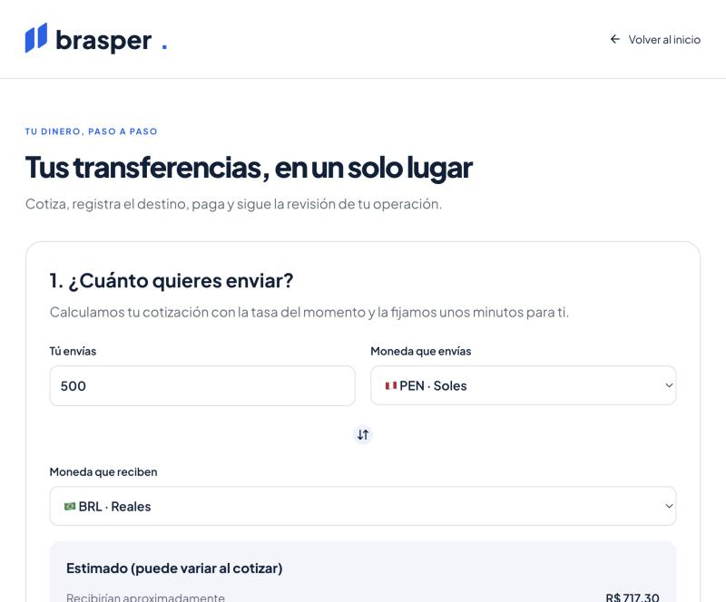
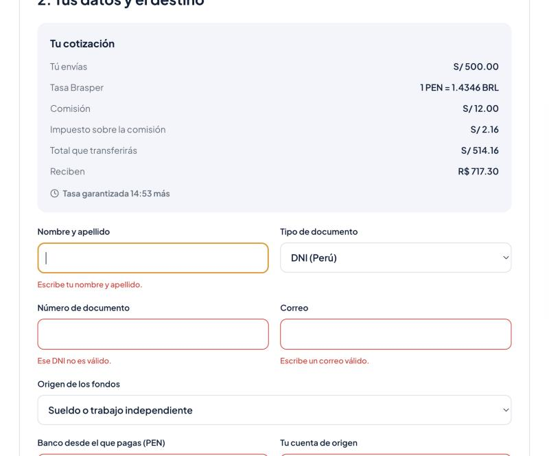
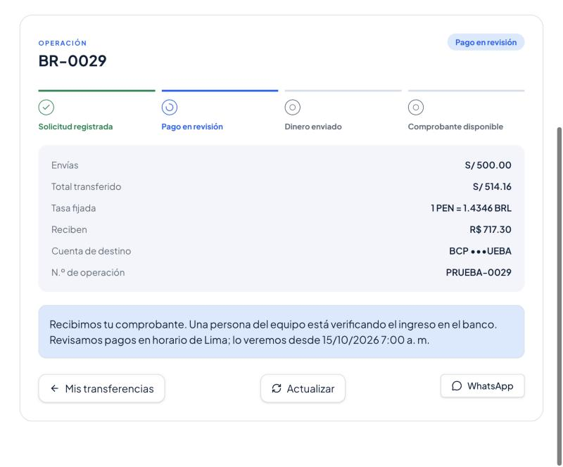
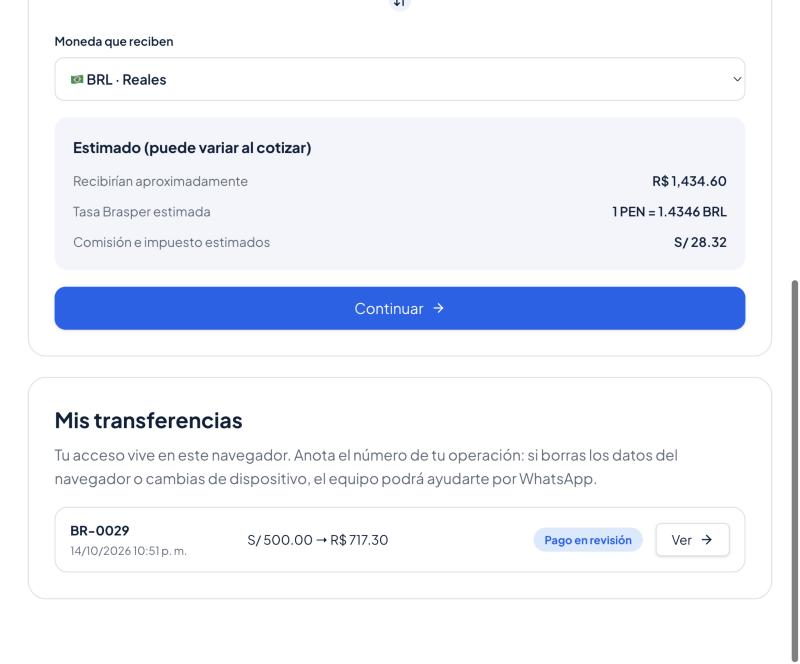
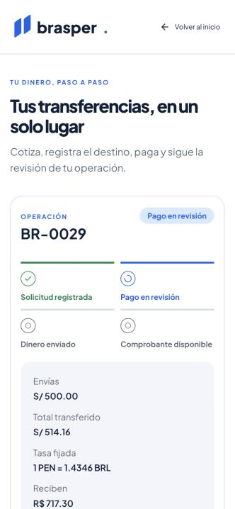

# Brasper Global Connect

Crea una landing page moderna, minimalista y responsiva para Brasper (transferencias internacionales entre Perú, Brasil y EE. UU.). Debe incluir:

1. Una sección principal (Hero) con un título llamativo enfocado en envíos seguros en minutos, un calculador rápido de divisas y un botón de llamada a la acción (CTA) para WhatsApp.

2. Una sección de características clave con iconos (más de 50 mil envíos, transacciones seguras, atención bilingüe, mejor tasa del mercado).

3. Una sección de bancos asociados (BCP, Banco do Brasil, NuBank, C6 Bank) y pruebas de confianza de su trayectoria.

4. Un formulario de contacto e información en el pie de página.

Usa una paleta de colores moderna con tonos corporativos (azules profundos) y acentos vibrantes.

This project was built with [Lovable](https://lovable.dev).

## Build with Lovable

Continue developing this project in the [Lovable editor](https://lovable.dev/projects/3238d75c-acc7-415b-889e-3acc9f1100b6).

- **Ship faster**: describe what you want to build and Lovable handles the code.
- **Stay in sync**: every change made in Lovable is committed straight to this repository.
- **Full ownership**: this code is yours. Push to `main` on GitHub and your changes sync back into Lovable, ready for your next prompt.

## Development

Prefer working locally? You need Node.js and npm — [install with nvm](https://github.com/nvm-sh/nvm#installing-and-updating).

```sh
git clone <this-repository-url>
cd <repository-name>
npm i
npm run dev
```

## Transferencias

El portal `/transferencias` funciona sobre las Cloud Functions de BRASPER (Firebase, proyecto `aibrasper`): cotiza con tasa fijada 15 minutos, registra la operación, muestra la cuenta de pago, recibe el comprobante y sigue el estado hasta el comprobante PDF. No requiere registro: el cliente entra como usuario anónimo silencioso y su acceso queda en este navegador. Consulta [la integración con el backend](docs/BACKEND_INTEGRATION.md) para el mapa del código, qué se guarda localmente y cómo apuntar a los emuladores.

Los flujos anteriores sobre Supabase (`docs/TRANSFER_WORKFLOW.md`, `/dashboard`, `/login`) ya no forman parte del recorrido del cliente. La revisión interna (aprobar, exportar, facturar) se hace con las funciones de staff del backend.

### Flujo del usuario

Capturas tomadas contra el backend real con datos de prueba.

**1. Calculadora en la página principal.** Muestra un estimado con la tasa de mercado (`getRates`); nunca es una cotización vinculante.


**2. Cotizar.** "Hacer mi cambio desde la web" lleva el monto y las monedas al portal. Al continuar, `createQuote` calcula las cifras definitivas.



**3. Cotización y datos.** La cotización del servidor fija la tasa por 15 minutos (con cuenta regresiva). El formulario valida documento, correo y cuentas antes de llamar a `createOrder`.



**4. Pagar y subir el comprobante.** Se crea la operación (`BR-xxxx`) y se muestra la cuenta de pago de Brasper, hoy marcada como **DEMO**. El cliente transfiere, escribe el número de operación del banco y adjunta una imagen o PDF de hasta 8 MB (Firebase Storage + `submitProof`).

**5. Seguimiento.** La operación pasa a "Pago en revisión" y la línea de tiempo se actualiza sola mientras el equipo valida el ingreso. Cuando la factura de prueba esté aceptada aparece "Descargar comprobante" (`getReceipt`).



**6. Volver más tarde.** El navegador recuerda un resumen de cada operación (sin documento, correo ni cuentas), así que la lista aparece de inmediato al regresar.



**Móvil.** Todo el flujo funciona en pantallas pequeñas.


